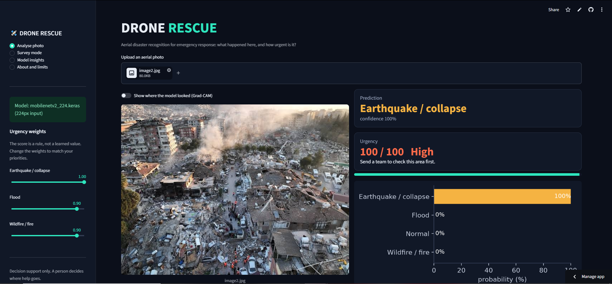
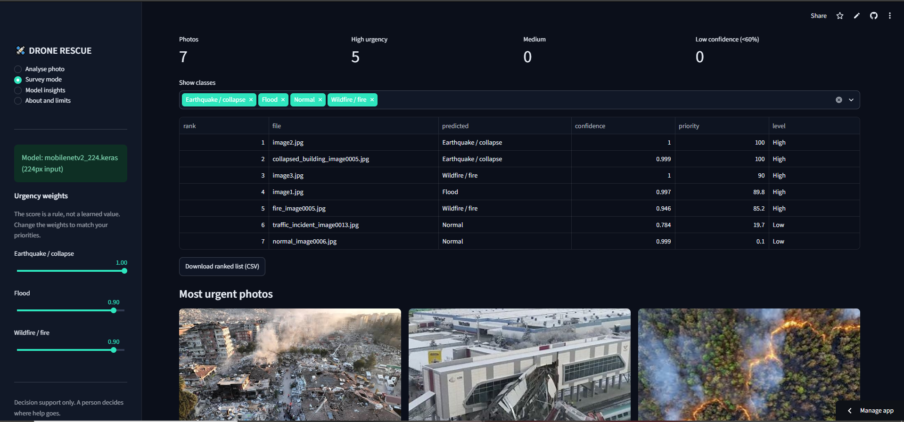
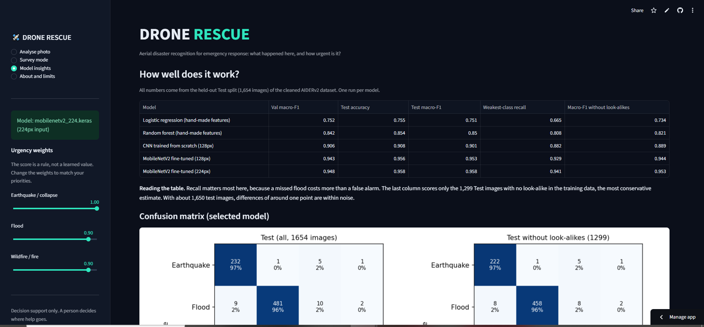
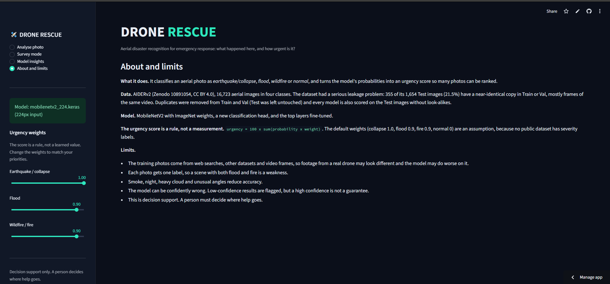

# DroneRescue

Aerial disaster recognition for emergency response. A web app reads drone photos taken after a disaster, labels each one
(flood, wildfire, earthquake/collapse or normal) and ranks the photos by urgency, so rescue teams can see where to look first.

## Screenshots

**Live demo:** https://dronerescue.streamlit.app/

**Analyse photo:** class, probabilities, urgency score and the Grad-CAM view of where the model looked.



**Survey mode:** a batch of photos from one flight, ranked by urgency.



**Model insights:** model comparison, confusion matrix and calibration.



**About and limits:** what the model was trained on and where it should not be trusted.



## Results at a glance

| | |
|---|---|
| Final model | MobileNetV2 (ImageNet weights), fine-tuned, 224x224 input |
| Test macro-F1 | 0.954 (95% interval 0.943 to 0.964) |
| Test accuracy | 0.953 (0.943 to 0.963) |
| Weakest class recall | 0.929 (Normal) |
| Real disaster called Normal | 2.0% of 1,177 disaster images |
| Normal scene flagged as disaster | 7.1% of 477 normal images |
| Calibration error (ECE) | 0.011 |

Scores are on the 1,654-image AIDERv2 Test set, which was never used for training or model selection. Details and caveats are below.

## Quick start

```bash
pip install -r requirements.txt        # Python 3.9 to 3.12, TensorFlow 2.16 or newer
streamlit run app/app.py
```

The app loads `models/mobilenetv2_224.keras` (or `models/mobilenetv2_128.keras`). To use a model stored elsewhere, set
`DRONERESCUE_MODEL=/path/to/model.keras`. Without a model file the app starts in a clearly marked **demo mode** with random
placeholder numbers.

**What to upload:** aerial or drone photos as JPG, JPEG or PNG. Images are resized to the model's input size automatically.
The model only knows four classes and has no "none of the above" option, so a photo from outside this domain still gets a label.

## How the urgency score works

The score is a rule applied to the model's class probabilities, for example
`100 x (0.9 x p_flood + 0.9 x p_fire + 1.0 x p_collapse)`. The weights are an assumption, not learned, because no public dataset
has severity labels. The sidebar sliders let the user change them. It is decision support, not a decision.

## Dataset

**AIDERv2** (Aerial Image Dataset for Emergency Response Applications), Zenodo record
[10891054](https://zenodo.org/records/10891054), licence CC BY 4.0. 16,723 aerial images in four classes
(Earthquake, Flood, Normal, Wildfire) with a ready-made train/validation/test split (13,399 / 1,670 / 1,654).

Please cite the dataset authors if you use it:

- Shianios, D., Kyrkou, C., Kolios, P.S. (2023). *A Benchmark and Investigation of Deep-Learning-Based Techniques
  for Detecting Natural Disasters in Aerial Images.* CAIP 2023. https://doi.org/10.1007/978-3-031-44240-7_24
- Kyrkou, C., Theocharides, T. (2020). *EmergencyNet: Efficient aerial image classification for drone-based
  emergency monitoring using atrous convolutional feature fusion.* IEEE JSTARS 13, 1687-1699.

The images were collected from web searches, other public datasets and YouTube videos, so a model trained on them may perform
worse on footage from a real drone.

## Phase 0: data checks and leakage

All 16,723 files were readable and the class counts match the published table. The data has a leakage problem, which any
benchmark number on the original split inherits:

- 795 groups of near-identical images. Visual inspection (`outputs/dup_pairs_*.png`) shows the matched pairs are the same
  picture or frames of the same clip.
- **355 of the 1,654 Test images (21.5%) have a look-alike in Train or Val.** Wildfire is the most affected.
- Cleaning (Test untouched): Train 13,399 to 11,919 images, Val 1,670 to 1,563. One picture carried two class labels and was dropped.

| After cleaning | Earthquake | Flood | Normal | Wildfire | Total |
|---|---|---|---|---|---|
| Train | 1,886 | 3,970 | 3,704 | 2,359 | 11,919 |
| Val | 237 | 502 | 477 | 347 | 1,563 |
| Test (unchanged) | 239 | 502 | 477 | 436 | 1,654 |

Every model is scored on Val, on all of Test, and on the 1,299 Test images **without** a look-alike (the "unexposed" subset).
The unexposed score is the more conservative estimate. Test images with look-alikes stay in Test and are flagged, so results can
be compared with other work.

Duplicate rule (`01_eda_dedupe.py`): two images count as the same if their 64-bit perceptual hashes are within 5 bits and their
16x16 grey thumbnails are close. Corrupt files are dropped, a Train image that also appears in Val or Test is dropped from Train,
a Val image that also appears in Test is dropped from Val, and copies inside one split are reduced to one.

## Phase 1 and 2: models and results

All models use 128x128 input unless stated. Each was trained once. Models were selected on validation macro-F1 only, and Test was
used for the final report. "Min-class recall" is the recall of the weakest class. "Unexposed" is macro-F1 on the 1,299 Test images
without a look-alike.

| Model | Val macro-F1 | Test accuracy | Test macro-F1 | Min-class recall | Unexposed macro-F1 |
|---|---|---|---|---|---|
| Logistic regression (63 hand-made features) | 0.752 | 0.755 | 0.751 | 0.665 | 0.734 |
| Random forest (63 hand-made features) | 0.842 | 0.854 | 0.850 | 0.808 | 0.821 |
| CNN from scratch, no class weights | 0.891 | 0.914 | 0.908 | 0.874 | 0.898 |
| CNN from scratch, class weights | 0.889 | 0.901 | 0.895 | 0.868 | 0.879 |
| MobileNetV2, frozen head only (128px) | 0.892 | n/a | 0.889 | n/a | n/a |
| MobileNetV2, fine-tuned (128px) | 0.951 | 0.964 | 0.961 | 0.958 | 0.955 |
| MobileNetV2, frozen head only (224px) | 0.856 | n/a | 0.875 | n/a | n/a |
| MobileNetV2, fine-tuned (224px) | 0.945 | 0.953 | 0.954 | 0.929 | 0.951 |

Per-class recall on Test (all images / unexposed images):

| Model | Earthquake | Flood | Normal | Wildfire |
|---|---|---|---|---|
| Random forest | 0.81 / 0.80 | 0.87 / 0.87 | 0.87 / 0.85 | 0.84 / 0.71 |
| CNN, no class weights | 0.87 / 0.87 | 0.94 / 0.94 | 0.92 / 0.91 | 0.89 / 0.84 |
| CNN, class weights | 0.92 / 0.92 | 0.90 / 0.90 | 0.87 / 0.85 | 0.92 / 0.85 |
| MobileNetV2 fine-tuned, 128px | 0.96 / 0.96 | 0.96 / 0.96 | 0.96 / 0.95 | 0.97 / 0.95 |
| MobileNetV2 fine-tuned, 224px | 0.97 / 0.97 | 0.96 / 0.96 | 0.93 / 0.92 | 0.97 / 0.96 |

What the results show:

- **Neural networks beat hand-made features.** The scratch CNN is about 5 to 6 points of macro-F1 above the best feature model, and its weakest class is much better.
- **Fine-tuning is what made transfer learning work.** Training only a new head on the frozen MobileNetV2 scored 0.875 to 0.889 on Test,
  no better than the scratch CNN. Fine-tuning the last 40 layers reached 0.954 to 0.961, roughly 5 to 7 points above the scratch CNN.
- **Class weights had no clear overall benefit.** They moved recall toward the rarer classes (Earthquake 0.87 to 0.92, Wildfire 0.89 to 0.92)
  and away from Flood and Normal, and macro-F1 was slightly lower with them (0.895 against 0.908). With 240 to 500 test images per class
  and one run per model, differences of about 2 points should not be read as real.
- **Resolution made no clear difference.** 128px scored 0.961 and 224px 0.954 on Test. Both are inside each other's uncertainty range.

### Model choice

By the rule fixed in advance (best validation macro-F1), the 128px MobileNetV2 (0.951) edges out the 224px one (0.945), and it is cheaper
per image. The app and the Phase 3 evaluation use the 224px model because Phase 3 was run on it. The two are statistically hard to tell apart
on this Test set, so the choice does not change the conclusions. To use the 128px model instead, run
`python scripts/08_final_evaluation.py --model models/mobilenetv2_128.keras` and point the app at it with `DRONERESCUE_MODEL`.

### Leakage experiment

The same CNN (with class weights) was trained on the official, uncleaned split and scored on the same Test set.

| Training split | Test macro-F1 | Unexposed macro-F1 |
|---|---|---|
| Original, with duplicates (`cnn_original`) | 0.885 | 0.868 |
| Cleaned (`cnn_scratch`) | 0.895 | 0.879 |

The model trained on the original split did **not** score higher. The 1 point gap goes the other way and is within noise for a single run each.
So for a small CNN on this data there is no evidence that the duplicates inflated the score. That does not make the cleaning unnecessary:
it removes known leakage so the numbers can be trusted without that caveat, and a larger model could exploit duplicates more.

## Phase 3: final evaluation of the 224px model

```bash
python scripts/08_final_evaluation.py --model models/mobilenetv2_224.keras
```

| Evaluation set | Accuracy | Macro-F1 | Weakest-class recall |
|---|---|---|---|
| All of Test (1,654 images) | 0.953 (0.943 to 0.963) | 0.954 (0.943 to 0.964) | 0.929 |
| Test without look-alikes (1,299 images) | 0.950 (0.938 to 0.962) | 0.951 (0.939 to 0.963) | 0.920 |

Intervals are 95% bootstrap intervals from 1,000 resamples.

| Class | Precision | Recall | F1 | Images |
|---|---|---|---|---|
| Earthquake / collapse | 0.939 | 0.971 | 0.955 | 239 |
| Flood | 0.945 | 0.958 | 0.952 | 502 |
| Normal | 0.949 | 0.929 | 0.939 | 477 |
| Wildfire / fire | 0.977 | 0.966 | 0.971 | 436 |

- **The costly mistake.** A real disaster called Normal happens for 2.0% of the 1,177 disaster images. A normal scene flagged as a disaster
  happens for 7.1% of the 477 normal images. A missed disaster costs more than a false alarm, so the first number is the one to watch.
- **Calibration.** Mean confidence is 0.953 against an accuracy of 0.953, with an expected calibration error of 0.011, so the confidence
  values are trustworthy on this Test set. 3.2% of images get a confidence below 0.6, and the app flags those for a manual check.
- **Urgency score.** With the default weights, 99% of Earthquake, Flood and Wildfire images score 40 or higher, against 9% of Normal images.

Figures in `outputs/`: `final_confusion.png`, `final_reliability.png`, `final_priority_by_class.png`,
`final_confident_mistakes.png`, `final_gradcam.png`. The app's *Model insights* page shows them.

## The app

`streamlit run app/app.py` opens four pages:

- **Analyse photo:** upload one aerial photo to get the predicted class and confidence, the class probabilities, an urgency score from 0 to 100
  with a suggested action, a low-confidence warning below 60%, and an optional Grad-CAM view of where the model looked.
- **Survey mode:** upload up to 200 photos from one flight. They are ranked by urgency, with counts per class, the six most urgent photos,
  a CSV download, and an optional map if you upload a CSV with the columns `file, lat, lon` (AIDERv2 has no GPS data, so the map needs
  your own coordinates).
- **Model insights:** the model comparison and the evaluation figures above.
- **About and limits:** data, method and limitations.

The urgency weights (collapse 1.0, flood 0.9, fire 0.9, normal 0) can be changed with sliders in the sidebar. A model saved with Keras 3
needs TensorFlow 2.16 or newer to load.

## Repository layout

```
droneRescue/
├── src/dronerescue/     config.py, data.py (download, index), dupes.py (duplicate logic),
│                        pipeline.py (load cache), metrics.py (evaluation),
│                        priority.py (urgency rule), model_utils.py (load model, predict, Grad-CAM)
├── scripts/
│   ├── 00_download_data.py          download, checksum and unzip AIDERv2
│   ├── 01_eda_dedupe.py             explore, find duplicates and leakage, write the clean file list
│   ├── 02_inspect_duplicates.py     check how much the duplicate threshold matters
│   ├── 03_build_cache.py            resize the cleaned images once into uint8 arrays
│   ├── 04_baseline.py               hand-made features with logistic regression and random forest
│   ├── 05_cnn_scratch.py            small CNN trained from scratch
│   ├── 06_report.py                 side-by-side comparison of all trained models
│   ├── 07_transfer_mobilenetv2.py   MobileNetV2: frozen head, then fine-tuning
│   ├── 08_final_evaluation.py       confidence intervals, calibration, Grad-CAM, figures
│   └── make_demo_data.py            tiny synthetic dataset for smoke tests (not real photos)
├── app/app.py                       the Streamlit app
├── assets/                          screenshots used in this README
├── .streamlit/config.toml           dark theme
├── models/                          the trained MobileNetV2 model
├── outputs/                         plots, reports and result files
├── data/                            the dataset (not committed)
└── requirements.txt
```

## Reproducing the results

Run on Google Colab with a T4 GPU (Runtime > Change runtime type). Keep the data and outputs on Google Drive so a runtime reset does
not cost you the download or the trained models:

```python
from google.colab import drive
drive.mount("/content/drive")
import os
os.environ["DRONERESCUE_DATA"] = "/content/drive/MyDrive/dronerescue_data"
os.environ["DRONERESCUE_OUTPUT"] = "/content/drive/MyDrive/dronerescue_outputs"
```

```bash
pip install -r requirements.txt
python scripts/00_download_data.py            # about 1.5 GB, verifies checksums
python scripts/01_eda_dedupe.py
python scripts/02_inspect_duplicates.py
python scripts/03_build_cache.py --size 128
python scripts/04_baseline.py --size 128      # CPU is fine
python scripts/05_cnn_scratch.py --size 128
python scripts/05_cnn_scratch.py --size 128 --no-class-weights --tag cnn_noweights
python scripts/07_transfer_mobilenetv2.py --size 128 --tag mobilenetv2_128
python scripts/03_build_cache.py --size 224
python scripts/07_transfer_mobilenetv2.py --size 224 --tag mobilenetv2_224 --batch 32
python scripts/03_build_cache.py --size 128 --variant original      # leakage experiment
python scripts/05_cnn_scratch.py --size 128 --variant original --tag cnn_original
python scripts/06_report.py
python scripts/08_final_evaluation.py --model models/mobilenetv2_224.keras
```

Smoke test without the download: `python scripts/make_demo_data.py --out demo_data`, then run the scripts with `--data-dir demo_data`.
Training is not perfectly reproducible, so expect numbers within about a point of those above.

## Limitations

- Training images come from the web, so real drone footage may look different. No test was done on real drone footage or on photos
  from outside AIDERv2, so how well the model transfers is unknown.
- Each image gets one label, so mixed scenes (flood and fire together) are a weakness. The model also has no "none of the above" class.
- The urgency score is a hand-set rule, not learned, because there is no severity data.
- Each model was trained once, so differences of about one to two points are within noise.
- The 7.1% false-alarm rate on normal scenes means a human should confirm any flagged photo before resources are sent.
- The tool supports human decisions and does not replace them.
